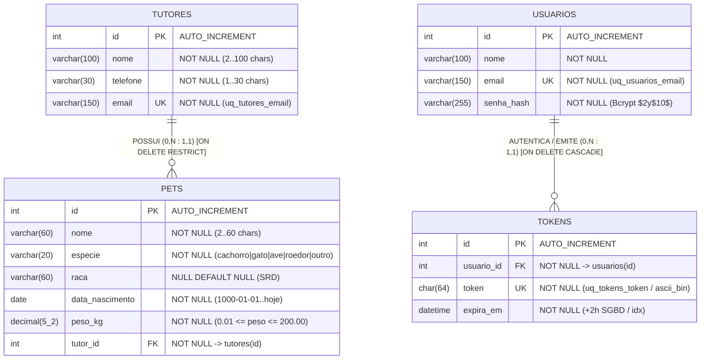

# Especificação Formal do Banco de Dados — MER & Mapeamento Relacional


> **Centro Universitário de Brasília (CEUB) — FATECS**  
> Faculdade de Tecnologia e Ciências Sociais Aplicadas • Engenharia de Dados e Desenvolvimento Back-End

| Metadado Arquitetural | Especificação |
| :--- | :--- |
| **Projeto** | API REST PetCare — Modelagem de Banco de Dados (MER) e Mapeamento Relacional |
| **Autores** | Eduardo Fernandes Alves • Rafael Torres Teixeira |
| **Referencial Teórico** | Elmasri & Navathe (*Sistemas de Banco de Dados*) / Algoritmo de 8 Passos (CEUB) |
| **Fonte da Verdade** | [`banco.sql`](../banco.sql) (MySQL 8 / MariaDB • Motor Transacional `InnoDB`) |
| **Codificação Padrão** | `utf8mb4` / `utf8mb4_unicode_ci` |
| **Collation do Token** | `CHAR(64) CHARACTER SET ascii COLLATE ascii_bin` *(coluna `tokens.token`)* |
| **Arquitetura Alvo** | Trabalho 1 (PHP 8+ Orientado a Objetos com PDO) & Trabalho 2 (Python FastAPI) |

---

## Sumário

1. [Diagrama Entidade-Relacionamento (Visualização Mermaid)](#0-diagrama-entidade-relacionamento-visualização-mermaid)
2. [Identificação e Minimundo (Requisitos de Dados)](#1-identificação-e-minimundo-requisitos-de-dados)
3. [Especificação das Entidades e Classificação dos Atributos (MER Conceitual)](#2-especificação-das-entidades-e-classificação-dos-atributos-mer-conceitual)
4. [Especificação Formal dos Relacionamentos, Grau, Participação e Cardinalidades](#3-especificação-formal-dos-relacionamentos-grau-participação-e-cardinalidades)
5. [Mapeamento Formal do MER para o Modelo Relacional (Algoritmo de 8 Passos — CEUB)](#4-mapeamento-formal-do-mer-para-o-modelo-relacional-algoritmo-de-8-passos--ceub)
6. [Dicionário de Dados Físico e Regras de Validação (MySQL 8 / MariaDB — InnoDB)](#5-dicionário-de-dados-físico-e-regras-de-validação-mysql-8--mariadb--innodb)
7. [Políticas de Integridade Referencial, Normalização e Segurança](#6-políticas-de-integridade-referencial-normalização-e-segurança)

---

## 0. Diagrama Entidade-Relacionamento (Visualização Mermaid)

O diagrama abaixo representa visualmente as 4 entidades do domínio **PetCare**, seus atributos tipados, chaves primárias (`PK`), chaves estrangeiras (`FK`), restrições de unicidade (`UK`) e cardinalidades estruturais:



> *(Nota de sintaxe Mermaid: `decimal(5_2)` representa o tipo físico `DECIMAL(5,2)`, pois o parser `erDiagram` do Mermaid não aceita vírgula dentro do identificador de tipo.)*

---

## 1. Identificação e Minimundo (Requisitos de Dados)

### 1.1. Descrição Formal do Minimundo — Clínica Veterinária PetCare

A clínica veterinária **PetCare** necessita de um banco de dados relacional transacional para manter o registro estruturado e íntegro de seus clientes responsáveis (**tutores**), dos pacientes animais atendidos (**pets**), do quadro de funcionários operadores do sistema (**usuários**) e das credenciais temporárias de sessão emitidas para controle de acesso HTTP (**tokens**).

* **Tutores (`tutores`):** No minimundo especificado, cada **tutor** representa o proprietário ou responsável legal pelos animais atendidos na clínica. De cada tutor devem ser armazenados obrigatoriamente um identificador único interno (`id`), o nome completo (`nome`, entre 2 e 100 caracteres), o telefone de contato (`telefone`, até 30 caracteres) e o endereço de e-mail (`email`, até 150 caracteres). Por exigência de negócio e comunicação exclusiva, o endereço de e-mail do tutor é único em todo o sistema (restrição `uq_tutores_email`), não sendo permitido o cadastramento de dois tutores com o mesmo e-mail. Um tutor pode ser cadastrado na recepção antes mesmo de possuir qualquer animal vinculado ou pode ter sob sua tutela múltiplos animais simultaneamente.
* **Pets (`pets`):** Cada **pet** representa um paciente animal submetido ao acompanhamento clínico da PetCare. De cada pet registram-se obrigatoriamente um identificador único (`id`), o nome do animal (`nome`, entre 2 e 60 caracteres), a espécie biológica (`especie`, restrita estritamente ao domínio fechado `{'cachorro', 'gato', 'ave', 'roedor', 'outro'}`), a data de nascimento (`data_nascimento`, data de calendário válida no formato `AAAA-MM-DD`, a partir de `1000-01-01` e não futura) e o peso corpóreo em quilogramas (`peso_kg`, valor decimal positivo entre `0,01` e `200,00 kg`). Adicionalmente, registra-se a raça do animal (`raca`, até 60 caracteres), sendo este o **único atributo opcional (anulável — `NULL`)** de todo o esquema de dados, de modo a contemplar animais Sem Raça Definida (SRD). Todo pet cadastrado depende obrigatoriamente da existência prévia de um único tutor responsável (`tutor_id`). Por regra estrita de proteção ao prontuário veterinário, o sistema proíbe a exclusão de qualquer tutor que possua pets vinculados.
* **Usuários (`usuarios`) e Tokens (`tokens`):** Para governança das operações da API REST, os funcionários da clínica são cadastrados como **usuários** operadores, contendo identificador único (`id`), nome do operador/setor (`nome`), e-mail corporativo único de login (`email`, protegido pela restrição `uq_usuarios_email`) e o hash criptográfico da senha (`senha_hash`, gerado via algoritmo Bcrypt). Quando um usuário se autentica com sucesso (rota `POST /login`), o sistema emite um **token** de sessão no padrão *Bearer Token*, composto por identificador próprio (`id`), vínculo obrigatório com o usuário autenticado (`usuario_id`), sequência hexadecimal aleatória única de 64 caracteres (`token`) e data/hora limite de expiração (`expira_em`, definida para 2 horas após a emissão).

### 1.2. Regras de Acesso Refletidas no Banco e Planejamento Arquitetural (PHP 8 POO & FastAPI)

* **Segregação entre Consultas Públicas e Escrita Autenticada:** As operações de leitura cadastral (`GET /tutores`, `GET /tutores/{id}`, `GET /tutores/{id}/pets`, `GET /pets`, `GET /pets?especie=` e `GET /pets/{id}`) são públicas. Em contrapartida, todas as operações de criação, atualização e exclusão (`POST`, `PUT`, `DELETE` em `/tutores` e `/pets`, além de `POST /logout`) exigem validação em tempo real na relação `tokens` (`WHERE t.token = ? AND t.expira_em > NOW()`).
* **Reaproveitamento Integral do Schema entre o Trabalho 1 (PHP 8 + POO + PDO) e o Trabalho 2 (Python + FastAPI):** O script [`banco.sql`](../banco.sql) concentra a inteligência de integridade diretamente no motor `InnoDB` (chaves primárias, chaves estrangeiras, índices únicos e políticas `ON DELETE RESTRICT` / `ON DELETE CASCADE`). Dessa forma, a mesma instância MySQL serve sem qualquer alteração estrutural tanto ao **Trabalho 1** (implementado em PHP 8 orientado a objetos com `PDO` e *Prepared Statements*) quanto ao **Trabalho 2** (implementado em Python com `FastAPI`, `SQLAlchemy` e validação `Pydantic`), garantindo semântica idêntica de códigos de status HTTP (`200`, `201`, `204`, `400`, `401`, `404`, `409 Conflict` e `422 Unprocessable Entity`).

---

## 2. Especificação das Entidades e Classificação dos Atributos (MER Conceitual)

### 2.1. Classificação Formal dos Tipos de Entidade: Forte vs. Fraca

> [!NOTE]
> **Fundamentação Teórica (Elmasri & Navathe) — Entidades Fortes vs. Dependência Existencial**  
> Segundo Elmasri & Navathe, um **Tipo de Entidade Forte (Regular)** é aquele que possui ao menos um atributo-chave próprio capaz de identificar univocamente cada uma de suas instâncias, independentemente de outras entidades. Já um **Tipo de Entidade Fraca** não possui atributos-chave próprios suficientes, dependendo de uma entidade proprietária identificadora e de uma chave parcial (discriminador).
>
> No projeto **PetCare**, as 4 entidades (`TUTOR`, `PET`, `USUARIO` e `TOKEN`) são formalmente projetadas como **Entidades Fortes** dotadas de chave primária substituta própria (`id`). Contudo, do ponto de vista semântico do minimundo, `PET` (em relação a `TUTOR`) e `TOKEN` (em relação a `USUARIO`) apresentam **Dependência Existencial** (participação total `(1,1)`): nenhuma instância de `PET` existe sem um `TUTOR` e nenhuma instância de `TOKEN` existe sem um `USUARIO`. Vale destacar que *toda entidade fraca possui dependência existencial, mas nem toda dependência existencial implica uma entidade fraca*, pois `PET` (`id`) e `TOKEN` (`id`, `token`) possuem identificadores globais próprios.

### 2.2. Quadros Analíticos de Classificação dos Atributos por Entidade

#### Entidade 1: `TUTOR` (Tipo de Entidade Forte — Cadastro de Clientes Responsáveis)

| Atributo Conceitual | Classificação Estrutural (Elmasri & Navathe) | Obrigatoriedade | Papel de Chave / Semântica |
| :--- | :--- | :---: | :--- |
| `id` | Simples • Monovalorado • Armazenado | **Obrigatório** (`NOT NULL`) | `PK` **Identificador Principal** — Chave substituta artificial (*surrogate key*). |
| `nome` | Simples (atômico) • Monovalorado • Armazenado | **Obrigatório** (`NOT NULL`) | Atributo Descritivo (tratado atomicamente sem decomposição em prenome/sobrenome). |
| `telefone` | Simples • Monovalorado • Armazenado | **Obrigatório** (`NOT NULL`) | Atributo Descritivo (telefone principal único de contato do responsável). |
| `email` | Simples • Monovalorado • Armazenado | **Obrigatório** (`NOT NULL`) | `UNIQUE` **Identificador Candidato** — Chave alternativa de negócio (`uq_tutores_email`). |

#### Entidade 2: `PET` (Tipo de Entidade Forte com Dependência Existencial de `TUTOR`)

| Atributo Conceitual | Classificação Estrutural (Elmasri & Navathe) | Obrigatoriedade | Papel de Chave / Semântica |
| :--- | :--- | :---: | :--- |
| `id` | Simples • Monovalorado • Armazenado | **Obrigatório** (`NOT NULL`) | `PK` **Identificador Principal** — Identificador global do prontuário do pet. |
| `nome` | Simples • Monovalorado • Armazenado | **Obrigatório** (`NOT NULL`) | Atributo Descritivo (nome do animal de estimação). |
| `especie` | Simples • Monovalorado • Armazenado | **Obrigatório** (`NOT NULL`) | Atributo Descritivo Discriminador (`cachorro`, `gato`, `ave`, `roedor`, `outro`). |
| `raca` | Simples • Monovalorado • Armazenado | *Opcional* (`NULL`) | Atributo Descritivo (admite valor nulo `DEFAULT NULL` para animais SRD). |
| `data_nascimento` | Simples • Monovalorado • Armazenado | **Obrigatório** (`NOT NULL`) | Atributo Descritivo Base (permite obter a *idade* como atributo derivado em consulta). |
| `peso_kg` | Simples • Monovalorado • Armazenado | **Obrigatório** (`NOT NULL`) | Atributo Descritivo Quantitativo (medida ponderal em quilogramas). |
| `tutor_id` *(Lógico)* | Simples • Monovalorado • Armazenado | **Obrigatório** (`NOT NULL`) | `FK` **Chave Estrangeira** — Materializa o relacionamento `POSSUI` (Passo 4). |

#### Entidade 3: `USUARIO` (Tipo de Entidade Forte — Funcionários Operadores da Clínica)

| Atributo Conceitual | Classificação Estrutural (Elmasri & Navathe) | Obrigatoriedade | Papel de Chave / Semântica |
| :--- | :--- | :---: | :--- |
| `id` | Simples • Monovalorado • Armazenado | **Obrigatório** (`NOT NULL`) | `PK` **Identificador Principal** — Identificador interno do operador. |
| `nome` | Simples • Monovalorado • Armazenado | **Obrigatório** (`NOT NULL`) | Atributo Descritivo (identificação nominal do funcionário ou setor). |
| `email` | Simples • Monovalorado • Armazenado | **Obrigatório** (`NOT NULL`) | `UNIQUE` **Identificador Candidato** — Credencial única de login (`uq_usuarios_email`). |
| `senha_hash` | Simples • Monovalorado • Armazenado | **Obrigatório** (`NOT NULL`) | Atributo Descritivo de Segurança (hash criptográfico Bcrypt irreversível). |

#### Entidade 4: `TOKEN` (Tipo de Entidade Forte com Dependência Existencial de `USUARIO`)

| Atributo Conceitual | Classificação Estrutural (Elmasri & Navathe) | Obrigatoriedade | Papel de Chave / Semântica |
| :--- | :--- | :---: | :--- |
| `id` | Simples • Monovalorado • Armazenado | **Obrigatório** (`NOT NULL`) | `PK` **Identificador Principal** — Chave primária substituta da sessão. |
| `usuario_id` *(Lógico)* | Simples • Monovalorado • Armazenado | **Obrigatório** (`NOT NULL`) | `FK` **Chave Estrangeira** — Materializa o relacionamento `AUTENTICA / EMITE` (Passo 4). |
| `token` | Simples • Monovalorado • Armazenado | **Obrigatório** (`NOT NULL`) | `UNIQUE` **Identificador Candidato** — Credencial opaca Bearer de 64 caracteres ASCII. |
| `expira_em` | Simples • Monovalorado • Armazenado | **Obrigatório** (`NOT NULL`) | Atributo Descritivo Temporal (instante limite de validade da sessão). |

---

## 3. Especificação Formal dos Relacionamentos, Grau, Participação e Cardinalidades

Abaixo apresenta-se a especificação formal dos dois relacionamentos do MER, empregando a notação de **Razão de Cardinalidade (`1:N`)** e a notação estrutural **`(min, max)`** (onde `min = 0` indica participação parcial/opcional e `min >= 1` indica participação total/obrigatória).

### 3.1. Relacionamento 1: `POSSUI` (entre `TUTOR` e `PET`)

```text
EXPRESSÃO ESTRUTURAL FORMAL: TUTOR (0, N) ────< POSSUI >──── (1, 1) PET
```

* **Grau e Razão de Cardinalidade:** Binário (Grau 2) com razão **`1:N` (Um-para-Muitos)** na direção `TUTOR → PET`.
* **Participação de `TUTOR`: `(0, N)` — Participação Parcial (Opcional):** Um tutor pode ser cadastrado na recepção antes de ter qualquer pet vinculado (mínimo `0` — exemplificado no seed pelo tutor `id = 6`, *Roberto Almeida Prado*) ou possuir vários pets (máximo `N`).
* **Participação de `PET`: `(1, 1)` — Participação Total (Obrigatória):** Todo pet cadastrado no sistema depende obrigatoriamente de estar associado a um único tutor existente (mínimo `1` e máximo `1`, imposto por `tutor_id NOT NULL`).

### 3.2. Relacionamento 2: `AUTENTICA / EMITE` (entre `USUARIO` e `TOKEN`)

```text
EXPRESSÃO ESTRUTURAL FORMAL: USUARIO (0, N) ────< AUTENTICA / EMITE >──── (1, 1) TOKEN
```

* **Grau e Razão de Cardinalidade:** Binário (Grau 2) com razão **`1:N` (Um-para-Muitos)** na direção `USUARIO → TOKEN`.
* **Participação de `USUARIO`: `(0, N)` — Participação Parcial (Opcional):** Um funcionário recém-cadastrado ou após efetuar `POST /logout` pode ter zero tokens ativos (mínimo `0`), ou múltiplos tokens de diferentes sessões (máximo `N`).
* **Participação de `TOKEN`: `(1, 1)` — Participação Total (Obrigatória):** Todo token Bearer de acesso é emitido exclusiva e obrigatoriamente para um único usuário autenticado (mínimo `1` e máximo `1`, imposto por `usuario_id NOT NULL`).

### 3.3. Matriz Consolidada dos Relacionamentos do MER

| Relacionamento | Grau | Razão | Entidade Lado 1 | `(min, max)` Lado 1 | Participação Lado 1 | Entidade Lado N | `(min, max)` Lado N | Participação Lado N |
| :--- | :---: | :---: | :---: | :---: | :--- | :---: | :---: | :--- |
| **`POSSUI`** | Binário (2) | `1:N` | `TUTOR` | `(0, N)` | Parcial (Opcional) | `PET` | `(1, 1)` | Total (Obrigatória) |
| **`AUTENTICA / EMITE`** | Binário (2) | `1:N` | `USUARIO` | `(0, N)` | Parcial (Opcional) | `TOKEN` | `(1, 1)` | Total (Obrigatória) |

---

## 4. Mapeamento Formal do MER para o Modelo Relacional (Algoritmo de 8 Passos — CEUB)

A transformação sistemática do Esquema Conceitual (MER) para o Esquema Relacional Lógico foi conduzida aplicando explicitamente os **8 Passos de Mapeamento de Elmasri & Navathe**, conforme adotado na disciplina de Banco de Dados da FATECS/CEUB:

* **PASSO 1 — Mapeamento dos Tipos de Entidades Fortes (Regulares):**  
  Para cada tipo de entidade forte $E$ do MER, cria-se uma relação $R$ contendo todos os seus atributos simples, definindo-se o identificador principal como Chave Primária (`PK = #id`) e preservando as chaves candidatas como restrições `UNIQUE`:
  * `TUTORES ( #id, nome, telefone, email [UNIQUE] )`
  * `PETS ( #id, nome, especie, raca, data_nascimento, peso_kg )` *[antes da migração da FK no Passo 4]*
  * `USUARIOS ( #id, nome, email [UNIQUE], senha_hash )`
  * `TOKENS ( #id, token [UNIQUE], expira_em )` *[antes da migração da FK no Passo 4]*

* **PASSO 2 — Mapeamento dos Tipos de Entidades Fracas:**  
  **Justificativa Formal:** Embora `PETS` e `TOKENS` possuam dependência semântica/existencial em relação a `TUTORES` e `USUARIOS`, optou-se no projeto físico por chaves primárias artificiais autoincrementáveis (`id INT AUTO_INCREMENT PRIMARY KEY`) em vez de chaves parciais compostas (como `(tutor_id, nome_pet)`). Isso garante identificadores escalares imutáveis nas rotas REST (`/pets/{id}`), evita conflitos se um tutor tiver dois animais com nomes iguais e mantém o índice *Clustered B+Tree* do `InnoDB` com apenas 4 bytes, tratando a obrigatoriedade do vínculo via restrição `NOT NULL` na chave estrangeira (Passo 4).

* **PASSO 3 — Mapeamento de Tipos de Relacionamentos Binários 1:1:**  
  **Declaração Formal ($\emptyset$):** O modelo conceitual não possui relacionamentos binários `1:1`, não gerando fusão de tabelas nem migração de chaves neste passo.

* **PASSO 4 — Mapeamento de Tipos de Relacionamentos Binários 1:N (Propagação da PK do Lado 1 para o Lado N):**  
  Para cada relacionamento binário `1:N`, identifica-se a relação $S$ que representa o tipo de entidade no lado `N` e inclui-se como **Chave Estrangeira (`FK`)** em $S$ a chave primária da relação $T$ que representa o tipo de entidade no lado `1`:
  * **4.1. Relacionamento `POSSUI` (`TUTORES 1:N PETS`):** Identifica-se a relação do lado `N` (`PETS`) e inclui-se a chave primária de `TUTORES` (`id`) como chave estrangeira `&tutor_id` em `PETS`. Devido à participação total `(1,1)` de `PET`, define-se `tutor_id INT NOT NULL` (com `ON DELETE RESTRICT ON UPDATE CASCADE`).
  * **4.2. Relacionamento `AUTENTICA / EMITE` (`USUARIOS 1:N TOKENS`):** Identifica-se a relação do lado `N` (`TOKENS`) e inclui-se a chave primária de `USUARIOS` (`id`) como chave estrangeira `&usuario_id` em `TOKENS`. Devido à participação total `(1,1)` de `TOKEN`, define-se `usuario_id INT NOT NULL` (com `ON DELETE CASCADE ON UPDATE CASCADE`).

* **PASSO 5 — Mapeamento de Tipos de Relacionamentos Binários N:M:**  
  **Justificativa de Escopo:** Ausência de tabelas associativas `N:M` no escopo atual, visto que a regra de negócio estabelece que cada pet cadastrado possui um único tutor responsável principal (`pets.tutor_id`).

* **PASSO 6 — Mapeamento de Atributos Multivalorados:**  
  **Justificativa (1FN):** Os atributos `telefone` e `email` foram modelados como atributos simples e monovalorados (contato principal único do tutor/usuário) conforme os requisitos do sistema, preservando a **1ª Forma Normal (1FN)** sem necessidade de tabelas auxiliares multivaloradas.

* **PASSO 7 — Mapeamento de Tipos de Relacionamentos n-ários ($n > 2$):**  
  **Declaração Formal ($\emptyset$):** Não aplicável por existirem apenas relacionamentos de grau binário ($n = 2$).

* **PASSO 8 — Opções 8A, 8B, 8C e 8D para Especialização / Generalização:**  
  **Nota Arquitetural (Aplicação Análoga à Opção 8C — Relação Única com Atributo Discriminador):** Dentre as alternativas de mapeamento de hierarquias (*8A: Tabelas para superclasse e subclasses; 8B: Tabelas apenas para subclasses; 8C: Tabela única com atributo discriminador de tipo; 8D: Tabela única com múltiplos flags booleanos*), para os tipos de animais (`cachorro`, `gato`, `ave`, `roedor`, `outro`) aplicou-se o conceito análogo à **Opção 8C** através do atributo discriminador obrigatório `especie VARCHAR(20) NOT NULL` na tabela única `pets`, visto que todos os animais compartilham os mesmos atributos estruturais (`nome`, `raca`, `data_nascimento`, `peso_kg`), evitando `JOIN`s desnecessários.

### 4.1. Esquema Relacional Resultante Consolidado (Notação Textual Formal)

> **Legenda de Notação Relacional:**  
> `#atributo` = Chave Primária (PK) | `&atributo -> tabela.pk` = Chave Estrangeira (FK) | `[UNIQUE]` = Chave Candidata/Alternativa

```text
1. tutores  ( #id, nome, telefone, email [UNIQUE] )
2. pets     ( #id, nome, especie, raca, data_nascimento, peso_kg, &tutor_id -> tutores.id )
3. usuarios ( #id, nome, email [UNIQUE], senha_hash )
4. tokens   ( #id, &usuario_id -> usuarios.id, token [UNIQUE], expira_em )
```

---

## 5. Dicionário de Dados Físico e Regras de Validação (MySQL 8 / MariaDB — InnoDB)

As quatro tabelas abaixo especificam o modelo físico implementado em [`banco.sql`](../banco.sql) (`ENGINE=InnoDB`, `DEFAULT CHARSET=utf8mb4 COLLATE=utf8mb4_unicode_ci`) em conjunto com as regras de validação de domínio impostas pelas classes de domínio e persistência em [`src/`](../src).

### 5.1. Relação Física: `tutores`

| Atributo / Coluna | Tipo Físico e Tamanho | Nulo? | Restrições / Índices (PK, FK, UQ, IDX) | Regras de Domínio e Validação na API (HTTP 422 / 409) | Descrição Semântica |
| :--- | :--- | :---: | :--- | :--- | :--- |
| `id` | `INT` | `NOT NULL` | `PK` `AUTO_INCREMENT` (Índice Clustered `PRIMARY`) | Gerado pelo SGBD no `POST /tutores`. Nas rotas `/tutores/{id}` (`\d+`), valores numéricos inexistentes (incluindo `0`) retornam `HTTP 404 ("Tutor não encontrado")`; demais formatos retornam `HTTP 404 ("Rota não encontrada")`. | Identificador único sequencial do tutor responsável. |
| `nome` | `VARCHAR(100)` | `NOT NULL` | — | `HTTP 422` String obrigatória entre **2 e 100 caracteres** após `trim()` (`/^.{2,100}$/u`). | Nome completo do cliente proprietário dos animais. |
| `telefone` | `VARCHAR(30)` | `NOT NULL` | — | `HTTP 422` String obrigatória não vazia entre **1 e 30 caracteres** após `trim()` (`/^.{1,30}$/u`). | Número de telefone fixo ou móvel para contato clínico. |
| `email` | `VARCHAR(150)` | `NOT NULL` | `UQ` `CONSTRAINT uq_tutores_email UNIQUE (email)` | `HTTP 422` Obrigatório, validado via `FILTER_VALIDATE_EMAIL` e até **150 caracteres** (`/^.{1,150}$/u`). `HTTP 409` Duplicidade (erro MySQL `1062`): `"E-mail já cadastrado"`. | Endereço de e-mail exclusivo do tutor na clínica. |

### 5.2. Relação Física: `pets`

| Atributo / Coluna | Tipo Físico e Tamanho | Nulo? | Restrições / Índices (PK, FK, UQ, IDX) | Regras de Domínio e Validação na API (HTTP 422 / 409) | Descrição Semântica |
| :--- | :--- | :---: | :--- | :--- | :--- |
| `id` | `INT` | `NOT NULL` | `PK` `AUTO_INCREMENT` (Índice Clustered `PRIMARY`) | Gerado pelo SGBD no `POST /pets`. Nas rotas `/pets/{id}` (`\d+`), valores numéricos inexistentes (incluindo `0`) retornam `HTTP 404 ("Pet não encontrado")`; demais formatos retornam `HTTP 404 ("Rota não encontrada")`. | Identificador único sequencial do prontuário do pet. |
| `nome` | `VARCHAR(60)` | `NOT NULL` | — | `HTTP 422` String obrigatória entre **2 e 60 caracteres** após `trim()` (`/^.{2,60}$/u`). | Nome pelo qual o paciente animal é identificado. |
| `especie` | `VARCHAR(20)` | `NOT NULL` | — | `HTTP 422` Obrigatório; restrito estritamente a: `cachorro`, `gato`, `ave`, `roedor` ou `outro` (no `POST`, `PUT` e filtro `?especie=`). | Classificação biológica da espécie do animal. |
| `raca` | `VARCHAR(60)` | `NULL` | `DEFAULT NULL` | `HTTP 422` Opcional (aceita `null` ou omissão). Se enviado, deve ser string de **até 60 caracteres** (string vazia é convertida em `null`). | Raça específica do animal ou `NULL` quando Sem Raça Definida (SRD). |
| `data_nascimento` | `DATE` | `NOT NULL` | — | `HTTP 422` Obrigatório no formato `AAAA-MM-DD`, data real de calendário entre **`1000-01-01` e hoje** (`America/Sao_Paulo`). | Data de nascimento do animal para cálculo etário e clínico. |
| `peso_kg` | `DECIMAL(5,2)` | `NOT NULL` | — | `HTTP 422` Obrigatório, numérico finito (`int` ou `float`), entre **`0.01` e `200.00`** (impede arredondamento sub-centavo para `0.00`). | Peso corpóreo atual em quilogramas com 2 casas decimais. |
| `tutor_id` | `INT` | `NOT NULL` | `FK` `fk_pets_tutor -> tutores(id)` `ON DELETE RESTRICT` • `ON UPDATE CASCADE` | `HTTP 422` Inteiro positivo que deve existir em `tutores.id` (erro MySQL `1452`). `HTTP 409` Bloqueia `DELETE /tutores/{id}` (erro MySQL `1451`). | Chave estrangeira que vincula o animal ao seu tutor responsável. |

### 5.3. Relação Física: `usuarios`

| Atributo / Coluna | Tipo Físico e Tamanho | Nulo? | Restrições / Índices (PK, FK, UQ, IDX) | Regras de Domínio e Validação na API (HTTP 422 / 401) | Descrição Semântica |
| :--- | :--- | :---: | :--- | :--- | :--- |
| `id` | `INT` | `NOT NULL` | `PK` `AUTO_INCREMENT` (Índice Clustered `PRIMARY`) | Identificador interno referenciado por `tokens.usuario_id` no momento do login. | Identificador único do funcionário operador da clínica. |
| `nome` | `VARCHAR(100)` | `NOT NULL` | — | Obrigatório no banco; recuperado no `INNER JOIN` do método `AutenticacaoServico::exigirToken()`. | Nome completo ou perfil operacional (ex.: Recepção Clínica). |
| `email` | `VARCHAR(150)` | `NOT NULL` | `UQ` `CONSTRAINT uq_usuarios_email UNIQUE (email)` | `HTTP 422` No `POST /login`, obrigatório, formato válido e até **150 caracteres**. `HTTP 401` Se inexistente: `"E-mail ou senha inválidos"`. | E-mail corporativo único utilizado como credencial de login. |
| `senha_hash` | `VARCHAR(255)` | `NOT NULL` | — | `HTTP 422` Campo `senha` obrigatório (até 255 bytes) no login. `HTTP 401` Validado via `password_verify($senha, $senha_hash)`. | Hash criptográfico Bcrypt (`$2y$10$...`). Senhas jamais são salvas em texto puro. |

### 5.4. Relação Física: `tokens`

| Atributo / Coluna | Tipo Físico e Tamanho | Nulo? | Restrições / Índices (PK, FK, UQ, IDX) | Regras de Domínio e Validação na API (HTTP 401 / 204) | Descrição Semântica |
| :--- | :--- | :---: | :--- | :--- | :--- |
| `id` | `INT` | `NOT NULL` | `PK` `AUTO_INCREMENT` (Índice Clustered `PRIMARY`) | Gerado automaticamente a cada autenticação bem-sucedida em `POST /login`. | Identificador único sequencial do registro de sessão. |
| `usuario_id` | `INT` | `NOT NULL` | `FK` `fk_tokens_usuario -> usuarios(id)` `ON DELETE CASCADE` • `ON UPDATE CASCADE` | Preenchido com `usuarios.id` no login e verificado via `INNER JOIN usuarios u ON u.id = t.usuario_id` em toda rota protegida. | Chave estrangeira que identifica o operador proprietário da sessão. |
| `token` | `CHAR(64) CHARACTER SET ascii COLLATE ascii_bin` | `NOT NULL` | `UQ` `CONSTRAINT uq_tokens_token UNIQUE (token)` (Índice Único Binário Case-Sensitive) | `HTTP 401` Extraído de `Authorization: Bearer <token>`; ausente retorna `"Token não informado"`, malformado/inválido retorna `"Token inválido ou expirado"`. Removido no `POST /logout` (`HTTP 204`). | Token hexadecimal opaco de 64 caracteres (256 bits via `bin2hex(random_bytes(32))`). |
| `expira_em` | `DATETIME` | `NOT NULL` | `IDX` `INDEX idx_tokens_expira_em (expira_em)` | `HTTP 401` Calculado no SGBD via `DATE_ADD(NOW(), INTERVAL 2 HOUR)`; validado via `AND t.expira_em > NOW()`. Tokens vencidos são limpos no login. | Carimbo de data e hora limite de validade da sessão Bearer. |

---

## 6. Políticas de Integridade Referencial, Normalização e Segurança

### 6.1. Política de Exclusão Referencial: `ON DELETE RESTRICT` vs. `ON DELETE CASCADE`

O projeto físico em [`banco.sql`](../banco.sql) adota deliberadamente duas ações referenciais distintas para exclusão (`ON DELETE`), subordinadas à natureza semântica e jurídica de cada entidade no domínio da clínica veterinária:

| Critério Arquitetural | `fk_pets_tutor` (`pets.tutor_id -> tutores.id`)<br>**Política:** `ON DELETE RESTRICT ON UPDATE CASCADE` | `fk_tokens_usuario` (`tokens.usuario_id -> usuarios.id`)<br>**Política:** `ON DELETE CASCADE ON UPDATE CASCADE` |
| :--- | :--- | :--- |
| **Natureza Semântica do Registro Filho** | **Prontuário Clínico Permanente (`pets`):** Representa uma vida animal atendida, cujo histórico clínico, peso e rastreabilidade médica não podem ser destruídos acidentalmente. | **Estado Efêmero de Sessão (`tokens`):** Representa apenas uma credencial transitória de autenticação com validade de 2 horas vinculada ao operador. |
| **Comportamento Físico no SGBD (MySQL InnoDB)** | Ao tentar executar `DELETE FROM tutores WHERE id = ?` para um tutor que possua pets associados, o motor `InnoDB` aborta a instrução e lança o código de erro MySQL **`1451`** (*Cannot delete or update a parent row: a foreign key constraint fails*). | Ao executar `DELETE FROM usuarios WHERE id = ?`, o motor `InnoDB` propaga a exclusão dentro da mesma transação ACID, apagando automaticamente todos os registros de `tokens` pertencentes àquele `usuario_id`. |
| **Tratamento na API REST e Código HTTP** | Em [`TutorRepositorio::excluir()`](../src/TutorRepositorio.php), o bloco `try/catch (PDOException $e)` intercepta o código `1451` e lança `ApiException::conflito(...)`, mapeada centralmente em [`index.php`](../index.php) para **`HTTP 409 Conflict`** com o payload `{"detail": "Não é possível excluir tutor que possui pets vinculados"}`. Caso o tutor não possua pets (ex.: tutor `id = 6`), a exclusão conclui com **`HTTP 204 No Content`**. | Garante revogação imediata e atômica de todas as sessões ativas de um funcionário desligado, impedindo que tokens emitidos anteriormente continuem autenticando requisições (retornando **`HTTP 401 Unauthorized`**). |

### 6.2. Conformidade Estrita com as Formas Normais (1FN, 2FN e 3FN)

* **Primeira Forma Normal (1FN — Atomicidade de Atributos):** Todas as quatro relações (`tutores`, `pets`, `usuarios`, `tokens`) possuem exclusivamente atributos de domínio atômico e monovalorado. Não existem grupos repetitivos, arrays serializados, listas separadas por vírgula ou tabelas aninhadas.
* **Segunda Forma Normal (2FN — Dependência Funcional Total da Chave Primária):** Uma relação está na 2FN quando está na 1FN e todo atributo não-chave é total e funcionalmente dependente de toda a chave primária (ausência de dependências parciais). Como todas as 4 relações do banco `petcare` possuem **chaves primárias simples mono-atributo (`#id`)**, é matematicamente impossível ocorrer dependência funcional parcial em relação a um subconjunto da chave primária. Logo, 100% do esquema satisfaz a 2FN por construção.
* **Terceira Forma Normal (3FN — Ausência de Dependências Transitivas):** Uma relação está na 3FN quando está na 2FN e nenhum atributo não-chave depende transitivamente da chave primária através de outro atributo não-chave ($X \rightarrow Y \rightarrow Z$).
  * Em `tutores`: `id -> {nome, telefone, email}` e `email -> id` (ambos são chaves candidatas; não há dependência entre `nome` e `telefone`).
  * Em `pets`: `id -> {nome, especie, raca, data_nascimento, peso_kg, tutor_id}`. Observe-se a **decisão exemplar de 3FN na API**: embora as rotas `GET /pets` e `GET /pets/{id}` retornem o atributo `tutor_nome` no JSON de resposta, **o nome do tutor jamais foi duplicado como coluna na tabela `pets`** (o que criaria a dependência transitiva `pets.id -> pets.tutor_id -> tutor_nome` e geraria anomalia de atualização quando o tutor alterasse seu nome em `PUT /tutores/{id}`). Em vez disso, `tutor_nome` é projetado dinamicamente via junção relacional (`SELECT p.*, t.nome AS tutor_nome FROM pets p INNER JOIN tutores t ON t.id = p.tutor_id`).
  * Em `usuarios` e `tokens`: Todos os atributos não-chave dependem única e diretamente de suas respectivas chaves (`id` e `email` em `usuarios`; `id` e `token` em `tokens`), sem qualquer transitividade.

### 6.3. Segurança Criptográfica de Dados e Engenharia de Collation

> [!IMPORTANT]
> **Armazenamento Irreversível de Senhas com Bcrypt (`usuarios.senha_hash VARCHAR(255) NOT NULL`)**  
> As senhas dos operadores nunca são armazenadas em texto puro nem sob algoritmos de hash rápidos vulneráveis a GPU (como MD5 ou SHA-256 simples). Utiliza-se a função nativa `password_hash($senha, PASSWORD_DEFAULT)` do PHP 8.2+, que emprega o algoritmo adaptativo **Bcrypt** (prefixo `$2y$10$`) com fator de custo 10 ($2^{10} = 1.024$ rodadas de expansão de chave Blowfish) e **sal aleatório criptográfico individual de 128 bits** embutido nos 60 caracteres do hash resultante. O dimensionamento em `VARCHAR(255)` segue a especificação oficial do PHP para suportar migração transparente para `PASSWORD_ARGON2ID`. A verificação no login utiliza `password_verify()` (incluindo verificação contra `DUMMY_BCRYPT_HASH` quando o e-mail não existe, mitigando enumeração por tempo de resposta).

#### Tokens Opacos de 256 bits e Collation Binária (`tokens.token CHAR(64) CHARACTER SET ascii COLLATE ascii_bin NOT NULL`)

1. **Geração CSPRNG:** Cada token é gerado por `bin2hex(random_bytes(32))`, extraindo 32 bytes (256 bits de entropia) do gerador pseudoaleatório criptograficamente seguro do sistema operacional e convertendo-os em exatamente 64 caracteres hexadecimais (`[0-9a-f]`).
2. **Alocação Fixa `CHAR(64)` com Charset `ascii`:** Como todo token possui invariavelmente 64 caracteres pertencentes ao alfabeto ASCII de 7 bits, sobrescrever o charset padrão da tabela (`utf8mb4`, até 4 bytes/caractere) por `CHARACTER SET ascii` reduz o espaço físico ocupado na linha e no índice B+Tree `uq_tokens_token` de 256 bytes para **exatos 64 bytes fixos**, sem byte adicional de prefixo de comprimento.
3. **Comparação Estrita Case-Sensitive via `COLLATE ascii_bin`:** Enquanto o collation geral do banco (`utf8mb4_unicode_ci`) é *case-insensitive* (tratando `'a' == 'A'`), o uso explícito de `COLLATE ascii_bin` obriga o MySQL a comparar os bytes exatos do token na cláusula `WHERE t.token = ? AND t.expira_em > NOW()`, garantindo determinismo criptográfico e máxima velocidade de busca por igualdade no índice único.
4. **Controle Temporal Stateful (`expira_em DATETIME NOT NULL`):** Calculado diretamente no SGBD via `DATE_ADD(NOW(), INTERVAL 2 HOUR)` sob `SET time_zone = '-03:00'` (eliminando deriva entre o relógio do PHP e o do MySQL), com limpeza de sessões vencidas no login via índice `idx_tokens_expira_em` e revogação explícita imediata via `DELETE FROM tokens WHERE token = ?` na rota `POST /logout`.
